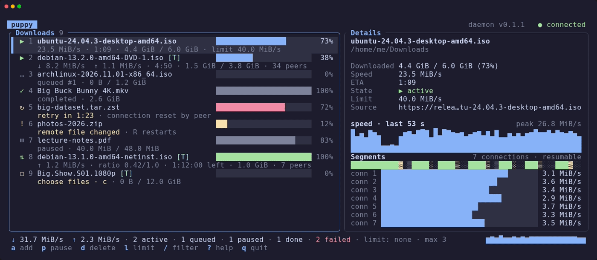

# puppy

A modern terminal download manager written in Rust. It downloads over HTTP(S),
FTP(S), SFTP and BitTorrent (magnet links and `.torrent` files), with a
full-screen dashboard. A background daemon owns every download and the queue,
so downloads keep going when no client is open; `puppy` talks to it over a
per-user local socket. It targets Linux, macOS
and Windows, on x86_64 and aarch64.

<picture>
  <source media="(prefers-color-scheme: light)" srcset="docs/hero-light.png">
  
</picture>

## Status

Early development (v0.2.1). What works today:

- **HTTP(S) engine**: segmented multi-connection downloads (8 connections by
  default) with robust resume. A resumed file is revalidated against the
  server (ETag / Last-Modified, or a byte comparison when the server offers
  neither) and is never silently continued if the remote file changed.
  Retries with backoff, per-download and global speed limits, proxies. One
  file can come from several mirrors at once, with failover between them
  (see [Mirrors](docs/mirrors.md)).
- **FTP and FTPS**: the same segmented downloads over `ftp://`, `ftps://`
  (implicit TLS) and `ftpes://` (explicit TLS) URLs, with `REST` resume,
  passive mode, TLS tried by default, and the same guarantee: a file whose
  size or modification time changed is never continued. See [FTP](docs/ftp.md).
- **SFTP**: the same segmented downloads over `sftp://` URLs, several SSH
  connections at once, logging in with ssh-agent, key files or a password in
  the URL, and host keys checked against `known_hosts` (`puppy ssh trust` to
  add one). See [SFTP](docs/sftp.md).
- **Metalink**: `.meta4` (RFC 5854) and Metalink 3 `.metalink` documents, local
  or fetched, become one download per file, from its mirrors at once, checked
  against its size and strongest hash. See [Metalink](docs/metalink.md).
- **Daemon**: a single instance per user owns the queue (3 active at a time by
  default), with atomically persisted state, a versioned JSON protocol,
  graceful shutdown, and an idle exit when started on demand.
- **Dashboard**: a full-screen terminal UI (`puppy`) to add, pause, resume,
  reorder, limit and delete downloads, with a live detail pane, dark and light
  themes, and monochrome / 16-color fallbacks.
- **BitTorrent**: magnet links and `.torrent` files (via
  [librqbit](https://github.com/ikatson/rqbit)), queued alongside HTTP
  downloads, with file selection, seeding limits, peers and a piece map. See
  [Torrents](docs/torrents.md).
- **Command line**: scriptable subcommands (`puppy add`, `ls`, `wait`, …) with
  `--json` output. See [Command line](#command-line).
- **Desktop notifications** when downloads finish or fail.
- **Browser extension** for Chrome-family browsers that hands their downloads
  to puppy. See [Browser downloads](#browser-downloads).

puppy is developed and tested on Linux. Release builds exist for macOS and
Windows, but they have seen little real use yet: reports are welcome.

## Demo

Adding two downloads, moving between them, pausing and resuming, the help screen, and
deleting:


Both are generated, not hand-made. `scripts/hero.sh` renders the screenshot above from
fixed sample data (needs cargo, [vhs](https://github.com/charmbracelet/vhs) and ffmpeg).
`vhs docs/demo.tape` records the GIF against a local throttled server (needs vhs,
`python3` and `puppy` on your `PATH`); it runs in throwaway directories.

## Install

Download the archive for your platform from the
[latest release](https://github.com/lavavrik/puppy/releases/latest):

| Platform              | Archive                                    |
|-----------------------|--------------------------------------------|
| Linux x86_64          | `puppy-<version>-x86_64-unknown-linux-gnu.tar.gz`  |
| Linux ARM64           | `puppy-<version>-aarch64-unknown-linux-gnu.tar.gz` |
| Linux x86_64, static  | `puppy-<version>-x86_64-unknown-linux-musl.tar.gz`  |
| Linux ARM64, static   | `puppy-<version>-aarch64-unknown-linux-musl.tar.gz` |
| macOS Apple silicon   | `puppy-<version>-aarch64-apple-darwin.tar.gz`      |
| macOS Intel           | `puppy-<version>-x86_64-apple-darwin.tar.gz`       |
| Windows x86_64        | `puppy-<version>-x86_64-pc-windows-msvc.zip`       |
| Windows ARM64         | `puppy-<version>-aarch64-pc-windows-msvc.zip`      |

Each archive holds the `puppy` binary, the browser extension (`extension/`),
the service files (`packaging/`), shell completions (`completions/`), man
pages (`man/man1/`), this README and the licenses. The Linux
`-gnu` builds need glibc 2.35 or newer (Ubuntu 22.04, Debian 12, Fedora 36 and
later). The `-musl` builds are statically linked and run on any Linux with that
CPU, including older distributions, Alpine and minimal containers. They look up
host names in `/etc/hosts` and the DNS servers in `/etc/resolv.conf` only, so
names that only `/etc/nsswitch.conf` modules resolve (mDNS `.local` names,
LDAP) are not found; use the `-gnu` build where you need those.
HTTPS and FTPS trust the system's CA certificates; on a system without any (a minimal
container without `ca-certificates`), the daemon falls back to Mozilla's root
list built into puppy and says so in its log.
`SHA256SUMS` in the release lists every archive's checksum.

**Linux and macOS:**

```sh
curl -fsSL https://raw.githubusercontent.com/lavavrik/puppy/main/scripts/install.sh | sh
```

**Windows** (PowerShell):

```powershell
irm https://raw.githubusercontent.com/lavavrik/puppy/main/scripts/install.ps1 | iex
```

The scripts ([install.sh](scripts/install.sh), [install.ps1](scripts/install.ps1))
pick the archive for your machine from the latest release, check it against
its SHA-256 and install `puppy`:

| System  | Binary goes to                          | Archive unpacked in (extension, service files) |
|---------|-----------------------------------------|------------------------------------------------|
| Linux   | `~/.local/bin/puppy`                    | `~/.local/share/puppy-install/`                |
| macOS   | `~/.local/bin/puppy`                    | `~/.local/share/puppy-install/`                |
| Windows | `%LOCALAPPDATA%\Programs\puppy\puppy.exe`, added to your `PATH` | `%LOCALAPPDATA%\puppy-install\` |

Set `PUPPY_VERSION=0.1.0` to install a particular version. On Linux and macOS, if
`puppy` is not found afterwards, add `~/.local/bin` to your `PATH`.

On Linux and macOS, `install.sh` also installs the shell completions, for
each of bash, zsh and fish found on the machine, and the man pages, all into
per-user folders under your home directory (see
[Shell completions and man pages](#shell-completions-and-man-pages)). zsh
needs one line in `~/.zshrc`; the script prints it.

On Linux, install.sh installs the `-gnu` build when the system has glibc 2.35 or
newer, and the static `-musl` build otherwise (no glibc, or an older one). Set
`PUPPY_LIBC=musl` or `PUPPY_LIBC=gnu` to choose:

```sh
curl -fsSL https://raw.githubusercontent.com/lavavrik/puppy/main/scripts/install.sh | PUPPY_LIBC=musl sh
```

**By hand:** download the archive from the release page, check it with
`shasum -a 256 -c <archive>.sha256`, unpack it and put `puppy` (`puppy.exe`)
anywhere on your `PATH`. The macOS and Windows binaries are not signed, so
when the archive comes from a browser, macOS refuses to run it at first (clear
the flag with `xattr -d com.apple.quarantine ~/.local/bin/puppy`) and
Windows SmartScreen may warn once. The install scripts download with
`curl` / PowerShell, which does not trigger either.

### Updates

puppy checks GitHub for a new release once a day and installs it by itself when
nothing is downloading and no dashboard, `puppy watch` or other client is open
(seeding does not count). Press Shift-U in the dashboard, or run `puppy update`,
to install right away; `puppy update --check` only looks. Your queue, settings
and downloads are kept, and a notification says "puppy updated to <version>".

- `[update]` in the config turns this off: `check = false` stops the daily
  check and automatic installs (puppy then only contacts GitHub when you run
  `puppy update`), `auto_install = false` only notifies (see Configuration).
- Development builds and `cargo install` builds do not update themselves; only
  the release binaries do.
- An install updates to the same build it is: a `-gnu` binary to the next `-gnu`
  archive, a static `-musl` binary to the next `-musl` one. To switch, run the
  install command again with `PUPPY_LIBC` set.
- A folder puppy cannot write to (such as an older macOS install in
  `/usr/local/bin`) only gets a notification: run the install command again.

## Build from source

Requires a recent stable Rust toolchain (edition 2024).

```sh
cargo build --release
```

The binary is `target/release/puppy`. To install it into `~/.cargo/bin`:

```sh
cargo install --path crates/puppy
```

A static Linux binary needs the musl target and a musl C compiler, `musl-gcc`
(the `musl-tools` package on Debian and Ubuntu), for the TLS library's C code:

```sh
rustup target add x86_64-unknown-linux-musl
TARGET_CC=musl-gcc cargo build --release --target x86_64-unknown-linux-musl -p puppy
```

The binary is `target/x86_64-unknown-linux-musl/release/puppy`.

## Run

```sh
puppy                 # open the dashboard, starting a daemon if none is running
puppy status          # print a one-line summary (more commands: "Command line" below)
puppy daemon          # run the daemon in the foreground (Ctrl-C stops it gracefully)
puppy --theme light   # override the theme: auto, dark or light
```

`puppy` needs an interactive terminal (it exits with status 2 otherwise). Quitting
the dashboard only disconnects; the daemon and its downloads keep running.

### Keys

| Key                               | Action |
|-----------------------------------|---------------------------------------------|
| `j` / `↓`, `k` / `↑`              | Move down / up |
| `g` / `Home`, `G` / `End`         | Jump to top / bottom |
| `a`                               | Add a download |
| `p`, `r`                          | Pause, resume |
| `d` / `Delete`                    | Delete (asks to confirm) |
| `R`                               | Restart (failed or needs-attention only) |
| `l`                               | Speed limit for the selected download |
| `c`                               | Choose a torrent's files (when it waits in `choosing`) |
| `s`                               | Seeding ratio / time for a torrent |
| `L`                               | Global speed limits |
| `+` / `-`                         | Raise / lower the number of active downloads |
| `Shift+↑` / `Shift+↓` (`K` / `J`) | Move in the queue |
| `/`                               | Filter |
| `U`                               | Update puppy now (when the update banner shows) |
| `Esc`                             | Close popup / clear filter |
| `<` / `>`                         | Move the divider between the list and the details (or drag it; double-click resets) |
| `?`                               | Help |
| `q` / `Ctrl+C`                    | Quit |

The footer shows the keys that apply to the current selection.

### Command line

Every command talks to the daemon, starting one if none runs (except `stop`).

```sh
puppy add https://example.com/a.iso         # a URL (HTTP(S), FTP(S), SFTP), magnet link or .torrent path
puppy add -o ~/isos --limit 2M URL1 URL2    # into a folder, at most 2 MiB/s each
puppy add -i list.txt                       # many downloads from an input file
puppy add --checksum sha-256=9f86d0… URL    # check the finished file
puppy add --mirror URL2 URL                 # one file from several places at once
puppy add --files 1,3-5 T                   # torrent: only these files
puppy ls                                    # table of downloads
puppy info 3                                # everything about download 3
puppy pause 3 4                             # pause (ids, or `all`); `resume` likewise
puppy rm 3 --delete-files                   # remove, and delete its files
puppy limit --global --down 5M              # global speed limit
puppy wait 3 4                              # wait until they finish
puppy watch                                 # print events as they happen
puppy update                                # install a newer puppy, if out
puppy stop                                  # stop the daemon
```

Add `--json` anywhere for output meant for scripts. `puppy --help` and
`man puppy-<command>` list every option. The full reference (JSON formats,
headers on redirects, file specs, checksums, input files) is in
[docs/cli.md](docs/cli.md).

### Protocols

- **HTTP(S)**: the default; 8 connections per download, set with
  `connections` in [config.toml](docs/configuration.md).
- **FTP and FTPS**: `ftp://` (TLS tried first), `ftps://` (implicit TLS) and
  `ftpes://` (TLS required). Anonymous unless the URL has a user. See
  [docs/ftp.md](docs/ftp.md).
- **SFTP**: `sftp://user@host/path`, logging in with your ssh-agent, then your
  default keys, then a password in the URL. Unknown hosts are refused until you
  `puppy ssh trust HOST`. See [docs/sftp.md](docs/sftp.md).
- **Mirrors**: `--mirror URL` (repeatable) spreads one file over several
  locations, mixing HTTP, FTP and SFTP. See [docs/mirrors.md](docs/mirrors.md).
- **Metalink**: `puppy add file.meta4`, or a `.meta4` / `.metalink` URL, adds
  every file it lists, with its mirrors and hash. See
  [docs/metalink.md](docs/metalink.md).
- **BitTorrent**: magnet links and `.torrent` files, with file selection
  (`--files`, `puppy select`) and seeding limits (`puppy seed`). See
  [docs/torrents.md](docs/torrents.md).

### Shell completions and man pages

The release archives carry completion scripts and man pages, and `install.sh`
installs them. To do it by hand, or after `cargo install`:

| Shell      | Where the script goes                                       |
|------------|-------------------------------------------------------------|
| bash       | `puppy completions bash > ~/.local/share/bash-completion/completions/puppy` (needs the `bash-completion` package) |
| zsh        | `puppy completions zsh > ~/.local/share/zsh/site-functions/_puppy`, with `fpath=(~/.local/share/zsh/site-functions $fpath)` before `compinit` in `~/.zshrc` |
| fish       | `puppy completions fish > ~/.config/fish/completions/puppy.fish` |
| PowerShell | `puppy completions powershell \| Out-String \| Invoke-Expression` in your `$PROFILE` |
| elvish     | `eval (puppy completions elvish \| slurp)` in `~/.config/elvish/rc.elv` |

For the man pages, `puppy man --dir ~/.local/share/man/man1` writes every page
there; then `man puppy` and `man puppy-add` work.

### Configuration

Settings go in `config.toml`, in `~/.config/puppy` on Linux and the data
directory elsewhere:

```toml
download_dir = "~/Downloads"
connections = 8         # per download
max_active = 3          # downloads at once
theme = "auto"          # "dark", "light"

[update]
auto_install = true     # install new releases when nothing is downloading
```

The daemon reads it at start: run `puppy stop` after a change. Every key
(proxy, torrents, notifications, FTP TLS, SSH) is in
[docs/configuration.md](docs/configuration.md). To keep downloading across
reboots, run the daemon as a login service: see
[docs/service.md](docs/service.md).

State lives in the platform data directory (`~/.local/share/puppy`,
`~/Library/Application Support/puppy` or `%APPDATA%\puppy`); the daemon's log
is `logs/puppyd.log` there. `PUPPY_HOME=<dir>` relocates both (config in
`<dir>/config`, data in `<dir>/data`).

## Browser downloads

An extension for Chrome, Chromium, Brave, Edge and Vivaldi hands the browser's
downloads to puppy, with their cookies. Firefox is not supported yet.

1. Run `puppy browser install` to register the native host.
2. Open `chrome://extensions`, turn on Developer mode, choose Load unpacked
   and pick the `extension/` folder from the release archive.

Alt+Shift+B lets the browser keep the next download. Settings, privacy and
known limits are in [docs/browser.md](docs/browser.md).

## Project layout

| Crate                     | What it is                                                      |
|---------------------------|-----------------------------------------------------------------|
| `crates/puppy`            | The `puppy` binary: dashboard, subcommands and native host.     |
| `crates/puppy-tui`        | The full-screen dashboard (ratatui).                            |
| `crates/puppy-core`       | The `Engine` trait, shared types and the HTTP(S)/FTP(S)/SFTP engine. |
| `crates/puppy-torrent`    | The BitTorrent engine (librqbit behind the `Engine` trait).     |
| `crates/puppy-daemon`     | The daemon: paths, config, queue manager, state store, server.  |
| `crates/puppy-proto`      | The daemon ↔ client protocol types and framing.                 |
| `crates/puppy-client`     | Client library: connecting, requests, events, auto-spawning.    |
| `crates/puppy-testserver` | HTTP, FTP(S) and SFTP servers for tests (throttling, failures). |
| `extension/`              | The browser extension (MV3) that hands downloads to puppy.      |

## Releasing

1. Bump `version` in the root `Cargo.toml`.
2. Write the release notes in `docs/releases/v0.2.0.md` (what changed, how to
   install, known issues; [v0.1.1](docs/releases/v0.1.1.md) is the model).
   The release workflow refuses to run without this file. Commit both.
3. Tag and push: `git tag v0.2.0 && git push origin v0.2.0`.
4. The [Release workflow](.github/workflows/release.yml) runs the tests on
   every platform, builds the eight archives and **publishes** the release with
   them, `SHA256SUMS` and the notes. Installs pick it up within a day. If any
   test or build fails, nothing is released: fix it and move the tag. A tag
   like `v0.2.0-rc.1` is published as a pre-release, which installs ignore.

The archives are built by `cargo build --profile dist` and
[`scripts/package.sh`](scripts/package.sh), which also run locally.
`package.sh` generates the completions and man pages by running the built
binary (or, when that binary is for another platform, a host build). The
workflow can be started from the Actions tab to build the archives without
making a release.

## License

Licensed under either of

- Apache License, Version 2.0 ([LICENSE-APACHE](LICENSE-APACHE))
- MIT license ([LICENSE-MIT](LICENSE-MIT))

at your option.

Unless you explicitly state otherwise, any contribution intentionally submitted
for inclusion in the work by you, as defined in the Apache-2.0 license, shall be
dual licensed as above, without any additional terms or conditions.
